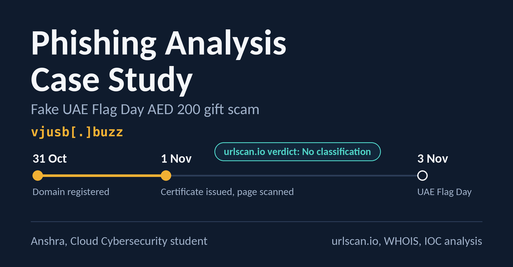

# Phishing Case Study: Fake UAE Flag Day AED 200 Gift

Investigation of a WhatsApp phishing scam claiming the UAE President was giving every resident AED 200 for Flag Day. I analyzed the link safely with urlscan.io and WHOIS, documented the indicators of compromise, and reported the domain.

**Full write-up:** [Case study PDF](Phishing%20Analysis%20Case%20Study%20Fake%20UAE%20Flag%20Day%20AED%20200%20Gift.pdf)

## Key finding

The domain was registered on 31 October 2026, one day before the campaign, yet urlscan.io and Google Safe Browsing showed no warning ("No classification"). Reputation tools lag behind fresh campaigns, so the evidence mattered more than the absence of a flag.

## Indicators of compromise

| Type | Value |
|---|---|
| Domain | vjusb[.]buzz |
| URL | hxxps://vjusb[.]buzz/dqWfbAJEcU/5772&s=wa&t=1793560536& |
| Registered | 31 October 2026 |
| Registrar | Spaceship, Inc. (owner hidden behind a privacy service) |
| TLS certificate | Issued 1 November 2026 by WE1 |
| Main IP (at scan) | 104[.]21[.]46[.]181 (Cloudflare) |
| Delivery channel | WhatsApp (`s=wa` tag in the URL) |

## What I found

- **Impersonation:** the page used du and e& logos and a photo of the President to look official.
- **Non-government domain:** a `.buzz` address, not `.gov.ae` or `.ae`.
- **Cloudflare fronting:** all IPs belonged to Cloudflare, hiding the real origin server. The IP is shared, so it did not identify the operator.
- **Single call to action:** a Vue.js single-page app with one "Tap here to get it now" button.
- **Built to spread:** the URL was tagged for WhatsApp forwarding.

## Method

1. Did not open the link in a browser.
2. Scanned the URL with urlscan.io (screenshot, network summary, IP/ASN data).
3. Checked the domain's WHOIS record and pivoted on the main IP.
4. Cross-checked the claim against official UAE government channels.

## Lessons

- "No classification" is not "safe". Treat an empty verdict on a brand-new domain as unknown.
- Confirm key indicators with a second source. urlscan's "5h old" tag was a first-seen time, and WHOIS gave the real registration date.
- Shared infrastructure limits attribution, so the useful actions were reporting to the registrar and the CDN.

## Status

Reported to the Abu Dhabi Police and the domain registrar on 1 November 2026. Takedown outcome pending; this README will be updated with the result.

## Tools

urlscan.io, WHOIS lookup

---
*By Anshra, Cloud Cybersecurity student. [LinkedIn](https://www.linkedin.com/in/anshra-subhaniee-109842355)*
